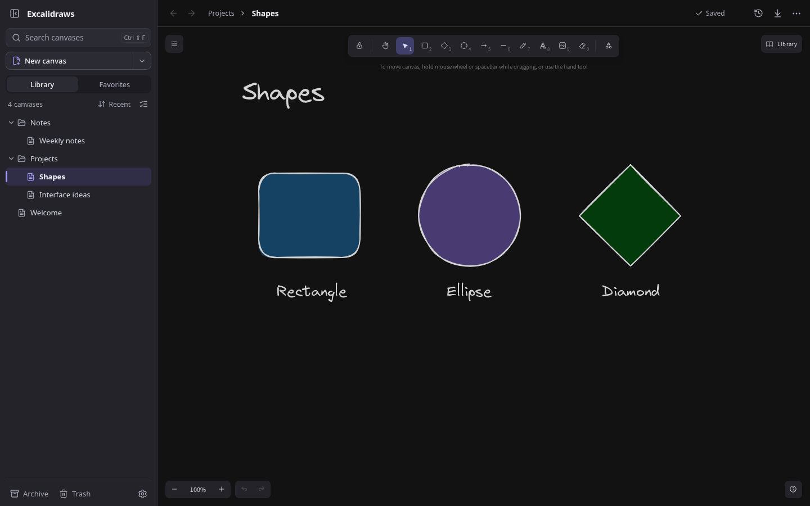

# Excalidraws

The official Excalidraw editor with a sidebar explorer and real files on your server.
Each canvas is an independent `.excalidraw` file: edit it in your browser, open it
in Excalidraw, or include its folder in your backups.

The workspace is built with Solid.js and Vite. The official React editor is an isolated,
lazy-loaded component; React does not render the sidebar, navigation, or contextual surfaces.

The integration uses `@excalidraw/excalidraw` and its public API. The editor remains
a dependency; this repository adds document management and a file service. It does
not maintain an editor fork or provide an installable plugin for excalidraw.com.



## Usage

- Settings at the bottom left of the sidebar offers System, Light, and Dark themes.
  System is the default and follows appearance changes immediately. A manual choice
  applies to the workspace and editor and is remembered in this browser.
- The Library keeps every canvas in its folder, including the one you are drawing on.
  Search by name or path; archived matches carry an Archive badge. Favorites provides
  quick access without moving files. Recent changes, Name, and Custom order are available.
- New canvas and New folder create at the top level. Use a folder's own creation action
  to create inside it. Default names are unique, including when another client creates
  an item first. New folders offer inline naming immediately; Escape keeps the default.
- Click the canvas title to rename it. On desktop, a pencil appears beside a row's name
  on hover or keyboard focus. Touch users can choose Rename from the visible `…` menu.
  Enter or the checkmark saves, Escape cancels, and leaving the field saves. A single
  draft keeps the header and row name synchronized without changing the file per keystroke.
- The `…` menu and right-click provide contextual actions. Move uses a searchable folder
  picker with a top-level destination and a move-out shortcut. Desktop dragging moves
  into folders; Custom order also supports insertion between rows. Move up/down and
  keyboard controls provide alternatives to dragging.
- Select several items to move, archive, or trash them together. Selecting a folder already
  includes its contents. Duplicate makes a separate canvas, including for inactive files.
- Archive hides completed work without changing its file path. Open Archive in the explorer
  to bring it back. An archived canvas can remain open and editable. Favorites, archive,
  and custom order are shared between devices through private workspace metadata.
- Sending an item to Trash is immediate and offers Undo. Trash stays inside the explorer;
  restore recreates missing parent folders and chooses a free name if the original is
  occupied. No existing file is replaced. Moves, archive changes, and custom order also
  offer Undo. Dismissing Undo does not remove items from Trash.
- The explorer supports keyboard navigation, F2 to rename, and contextual-menu keys.
  Organization shortcuts are scoped to the explorer so they do not replace drawing tools.
  Ctrl/Cmd+Shift+F focuses canvas search from anywhere. Ctrl/Cmd+K also works outside
  the editor; inside the editor it keeps its link-editing function.
- Hide the sidebar for more drawing space. Below 1024 px, or in a viewport shorter than
  500 px, it becomes an overlay drawer. Its focus stays contained while open. Touch
  controls have larger targets, and rare document actions move into the topbar menu.
- Each canvas has a `?canvas=` URL. Browser Back/Forward navigates canvases; renaming or
  moving updates the current location. Opening another canvas flushes the current drawing
  first. Failed loads preserve it; rapid selections cancel obsolete loads.
- Changes save automatically after a short pause, with a save scheduled within four seconds
  of continuous edits. Only one editor is mounted. Renaming, moving, favoriting, archiving,
  and ordering preserve the active editor, viewport, and drawing undo/redo history.
- Drawings include embedded images and retain scroll position and zoom. Import one or more
  `.excalidraw` files without replacing existing files, or download a canvas.
- Version history retains the last 20 previous versions and follows file and folder moves.
  Restoring a version creates a separate canvas with a readable name.
- External changes reload automatically when the editor is clean. With local edits, a
  conflict offers Save a copy, Download, or Load from server. Discarding the local version
  requires a second step inside the warning. Saving a copy preserves the remote version.

This is a personal workspace with conflict detection. It does not merge simultaneous edits.
When two clients save against the same revision, the second receives a conflict. External
file writers do not participate in the service lock. The revision is checked again immediately
before rename, but an external write in that narrow interval can still race with saving.
Avoid editing the same file in multiple tools at once.

The workspace and the embedded editor use English. Repository documentation, messages,
comments, identifiers, filenames, test data, and generated default names also use English.

## Development

Requires Node **22.12 or later**, npm, and Linux for the systemd installer.

```sh
npm ci
npm run dev
```

Open `http://localhost:5173`. Vite proxies the API to `127.0.0.1:3001`.
Files are stored in `./data/` by default, which is ignored by Git.

```sh
npm run build
npm start
```

The production build serves the frontend and API at `http://127.0.0.1:3001` by default.
Excalidraw assets and fonts are included; the editor does not require a CDN.

| Variable        | Default              | Purpose                                   |
| --------------- | -------------------- | ----------------------------------------- |
| `VAULT_DIR`     | `./data`             | Document folder                           |
| `HOST`          | `127.0.0.1`          | Listen address                            |
| `PORT`          | `3001`               | HTTP port                                 |
| `ALLOWED_HOSTS` | empty                | Additional DNS names, separated by commas |
| `PUBLIC_ORIGIN` | incoming HTTP origin | External origin when using an HTTPS proxy |

The API accepts `localhost`, the machine hostname, and IP addresses. For a Tailscale DNS
name or a reverse proxy, add the hostname to `ALLOWED_HOSTS` and preserve Host and Origin.
If the proxy terminates HTTPS, set `PUBLIC_ORIGIN=https://draw.example.com`
(installer option: `--origin`).

The API rejects foreign origins, hidden paths, traversal outside the vault, and symbolic
links. There are no accounts or authentication: use loopback or a trusted private network.
Public deployments need authentication and HTTPS in front of the service.
The document size limit is 40 MB.

## System service

The installer enables the system-wide `excalidraws.service` at boot and connects it to
the checkout where you run the installer. Every start or restart builds that checkout
before starting the server. Dependencies, including build tools, are installed on first
use and synchronized when the package files or Node version change. An unchanged
installation can rebuild without downloading dependencies.

Dependency installation and builds run as the non-root account selected by `--service-user`
(the invoking sudo user by default). That account needs Node, npm, and write access
to the checkout. Keep the checkout at its installed path; rerun the installer if you
move it. A failed build prevents the server from starting; inspect the journal for
the error. The vault stays outside the checkout.

```sh
node scripts/install-service.mjs --dry-run --host 0.0.0.0 --port 3000
# Access from localhost, LAN, and Tailscale:
sudo node scripts/install-service.mjs --host 0.0.0.0 --port 3000
# To restrict access to localhost:
# sudo node scripts/install-service.mjs --port 3000
```

The default port is 3000. The default vault is `.local/share/excalidraws/vault` inside
the service account's home directory. Use `--vault` to
keep a custom vault location. When running directly as root or through pkexec, specify
`--service-user username`. The installer never runs the server as root.

Existing user services are backed up, stopped, and disabled before starting the system
service. After a successful health check, the old user unit is removed. If activation
fails, the previous system and user service states are restored. Migrate while the
previous service user is logged in, and preserve its original `--host`, `--port`,
`--vault`, `--allowed-hosts`, and `--origin` values. The installer does not move or
rewrite drawings, change other services, or change Tailscale.

To update, pull the latest changes in the installed checkout and restart the service:

```sh
git pull --ff-only
sudo systemctl restart excalidraws.service
```

The restart waits for the build before starting the server. It builds the local files;
the service does not pull from Git. Existing installations using a copied release need
to run the installer once with their existing options to enable this behavior.

```sh
systemctl status excalidraws
sudo systemctl restart excalidraws
journalctl -u excalidraws -f
```

The service starts when the machine boots, independently of interactive logins.
User lingering is not required.

To roll back an installer change, copy a previous unit backup to
`/etc/systemd/system/excalidraws.service`, run `sudo systemctl daemon-reload`, and restart
the service. To roll back a code update, check out the desired revision in the installed
checkout and restart; the service builds that revision before starting.

To uninstall, run `sudo systemctl disable --now excalidraws`, remove the unit file,
and run `sudo systemctl daemon-reload`. You can remove the checkout and old releases separately;
keep the vault to retain your drawings.

### Migration and backups

The standard Excalidraw frontend stores drawings in the browser. Export those drawings as
`.excalidraw` files and import them here. Browser storage is not shared across ports.
This workspace does not delete the previous frontend's browser storage.

Back up **the entire vault**, including `.workspace/` for history and trash. Stop the service
for a consistent backup. When restoring with the service stopped, remove
`.workspace/server.lock` if necessary: a PID from another machine may match an active process.
Do not share the vault between multiple servers or let untrusted users edit its contents.
The lock prevents two local service instances; it does not coordinate multiple hosts over NFS.

Moving or renaming files and folders carries their saved history and workspace metadata
to the new path. Trash records retain both, and restore reattaches them at the final path.
Private `.workspace/library.json` stores favorites, archive flags, and sibling order; it
does not change document bytes or modification times.

Local draft writes are grouped over 250 ms; editor snapshots are also coalesced. Switching,
exporting, and hiding the page flush pending editor snapshots. Draft availability depends
on browser storage. The “Saved” status confirms that the server accepted the current changes,
including any pending editor snapshot.
Keep the page open until that status appears; the browser warns about unsaved changes.

The sidebar virtualizes long lists. A shared filesystem watcher notifies visible clients
of changes over server-sent events instead of repeatedly polling documents or scanning the
vault. Hidden pages disconnect and check for changes when visible again. Changes made by
external tools are detected, but concurrent edits are still resolved as conflicts, not merged.

## Checks and updates

```sh
npm test
npm run build
npx playwright install chromium  # Only if Chromium is not installed yet.
npm run test:e2e
```

Server and session tests cover images, concurrent writes, external changes, paths, symbolic
links, trash, history, drafts, and edits made while a save is in flight. Playwright uses the
production build with a temporary vault to test drawing, quick switching, reloads, conflicts,
recovery after save failures, imports, exports, mobile layouts, obsolete-load cancellation,
idle network activity, and a library of 300 canvases. These tests do not use
the personal vault or the installed service.

Versions are pinned in `package.json` and `package-lock.json`. Overrides address known
advisories in Excalidraw's transitive dependencies: nanoid, lodash-es, and KaTeX.
When updating, review the editor changelog and overrides, run `npm run check` and `npm audit`,
and inspect drawing, text, arrows, images, viewport state, and imports.
`src/editor/ExcalidrawAdapter.tsx` is the integration boundary with Excalidraw 0.18.1.

Architecture and decisions: [docs/PLAN.md](docs/PLAN.md).
Design council and interaction decisions: [docs/UX-DESIGN.md](docs/UX-DESIGN.md).
Verification evidence: [docs/VALIDATION.md](docs/VALIDATION.md).
